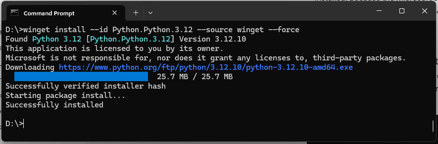

# Installatie Python en Visual Code
## Installatie Python


:::{warning} Belangrijk
De opdrachten in deze workshop werken alleen met versie 3.12 van Python.
:::

::::{tab-set}

:::{tab-item} Microsoft store


Open een windows console of PowerShell en voer het volgende commando uit om Python te installeren:

```powershell
winget install --id Python.Python.3.12 --source winget --force
``` 



:::

:::{tab-item} Python Website

Download de laatste versie van Python van af de [Python-website](https://www.python.org/downloads/).
Voer de installatie uit!
>Let op: 
>* Vink "Add Python to PATH" aan (belangrijk!)
>* Onthoud de installatie-locatie 


:::

::::

## Installatie Visual Code
Visual Code is een Integrated Development Environment om eenvoudig Python programma's te ontwikkelen.
Download de laatste versie van Visual Code van af de [Visual Code-website](https://code.visualstudio.com/)
Voer de installatie uit!

:::{warning} Belangrijk
Visual Code moet correct worden geïnstalleerd om Python-programma's te kunnen ontwikkelen.
::: 

### Installatie Visual Code-extensie voor Python
Installeer in Visual Code de Python-extensie om eenvoudig Python-programma's te kunnen ontwikkelen.

Ga naar de extensies-sectie in Visual Code, zoek naar "Python" en klik op "Installeren".


